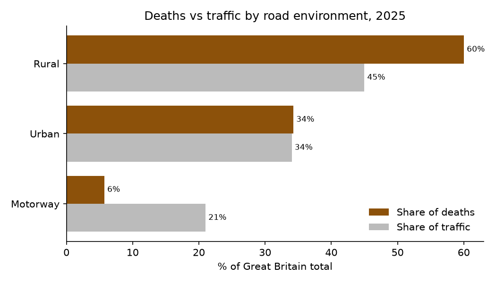
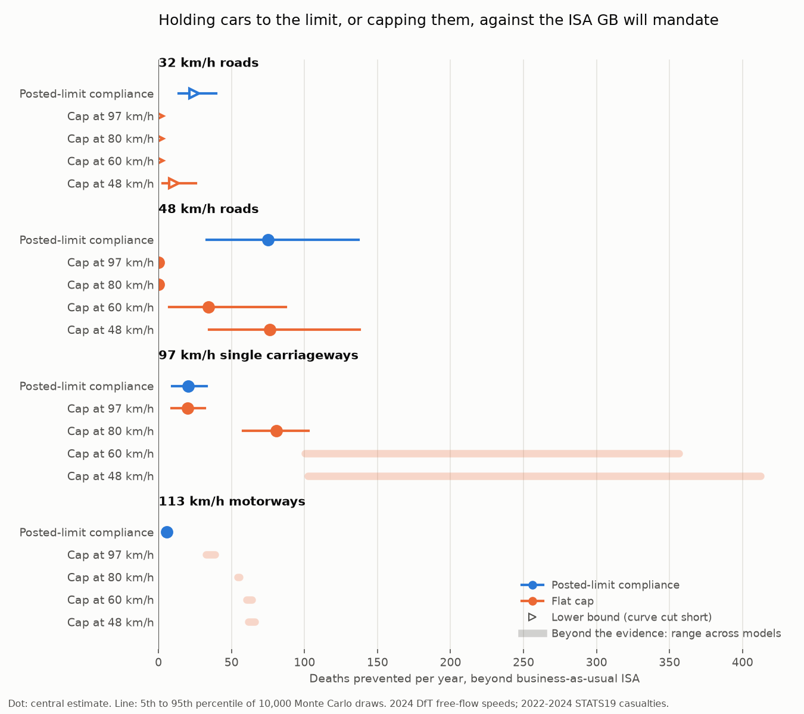
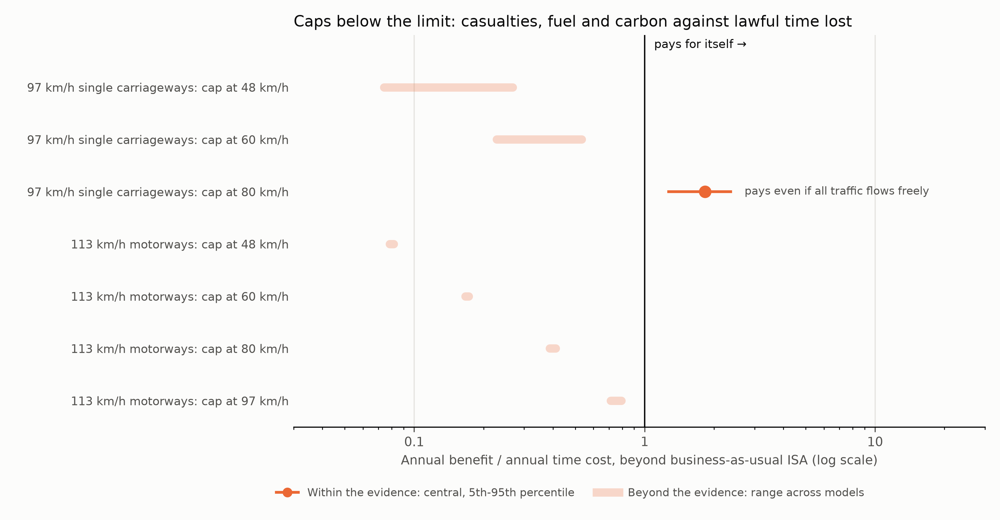
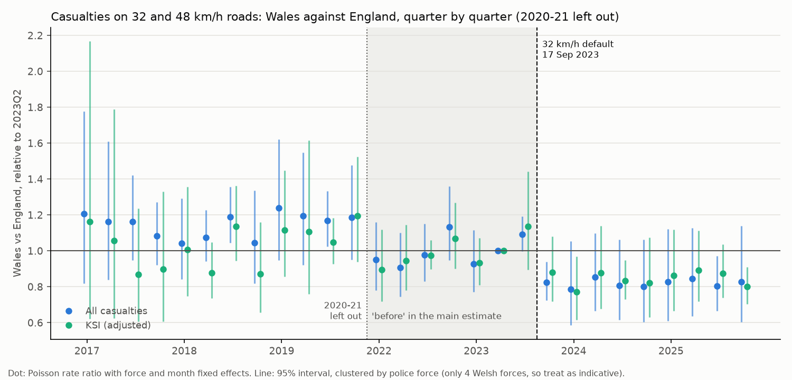
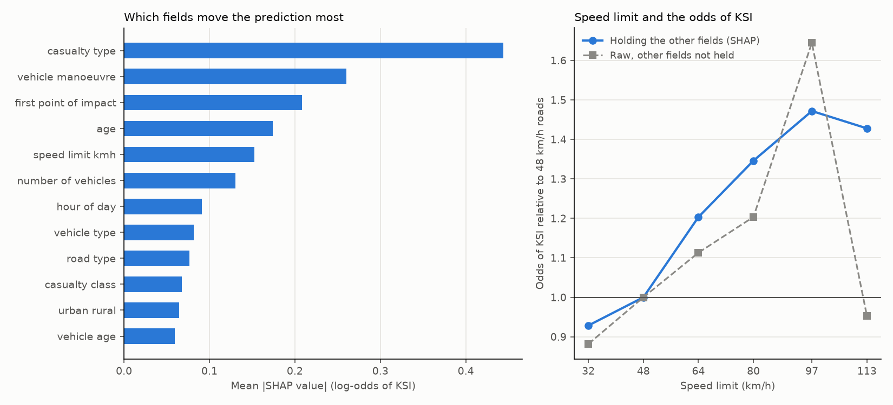

# Binding the Limit

[](https://github.com/Momerf988/speed-constraint-gb/actions/workflows/ci.yml)

Would capping how fast cars can go save enough lives in Great Britain to be worth the extra
travel time? And would it beat simply holding every car to each road's posted limit?

This project answers that with the government's own data and appraisal values: every
police-reported injury collision since 1979, DfT traffic and speed statistics, and DfT's
official values for a prevented casualty and for an hour of travel time.

**Status:** Phases 1–8 complete; Phase 9 under way (CI/CD done, Azure deployment next). The
casualty, appraisal and Wales results were revised in November 2026 after an examiner-style review:
vans now have their own speeds and limits, the baseline represents the ISA being mandated more
faithfully, fuel and carbon are counted, and every headline is reported with the range across models.
A second round judged every cap against compliance, which it contains, took the ISA override shares
from the trial paper itself, and made the Wales estimate rest on tests that treat Wales as one place. All 37.5 million STATS19 rows (1979–2025) are loaded into
PostgreSQL and modelled with dbt into a tested star schema, joined to DfT traffic and
free-flow speed statistics. A casualty model in Python estimates the deaths and injuries each
policy would prevent, with Monte Carlo ranges and an explicit label wherever a scenario goes
beyond the evidence, and an appraisal prices them against the travel time each policy costs,
using DfT's TAG values. A causal study of Wales's 2023 default 32 km/h limit and a
machine-learning severity model check the picture against what actually happened on the roads.

## Pipeline

```
DfT files → PostgreSQL (raw) → dbt: staging → intermediate → star schema → Parquet → Python model
```

| Layer | What it holds |
|---|---|
| `raw` | The three STATS19 tables exactly as published, with primary and foreign keys; DfT traffic (TRA0202, TRA0204) and free-flow speeds of cars and vans (SPE0102) |
| `staging` | Clear names, `-1` "unknown" codes turned into nulls (views) |
| `intermediate` | km/h speed limits, DfT road categories, keys, reported and adjusted severity (views) |
| `marts` | Star schema: `fct_casualty`, `fct_collision`, `dim_date`, `dim_road`, `dim_police_force`, `dim_casualty_profile`, plus aggregates for rates, car and van speed bands, the casualty baseline, traffic per road type, collisions per casualty and a monthly police-force panel (tables) |
| `model/` | Python: speed distributions, policies, speed-risk curves, Monte Carlo, structural range and appraisal (time, casualties, fuel, carbon), with every parameter and £ value traced to its source cell; difference-in-differences, synthetic control, triple difference and permutation tests; the severity model |

91 data tests run on every build: key uniqueness, fact-to-dimension relationships, allowed
values, row conservation from raw to facts and into the model's inputs, the rules of DfT's
severity adjustment, and reconciliation against DfT's published casualty, traffic and speed
figures. 119 pytest tests cover the models, the appraisal and the causal and machine-learning code.

## Continuous integration and delivery

Every push runs three jobs on GitHub Actions (`.github/workflows/ci.yml`):

- **Python tests:** all 119; the one that re-reads DfT's raw appraisal spreadsheet is skipped,
  because CI does not hold it.
- **The whole pipeline on a sample:** raw load, keys, code lookups, traffic, speeds, every dbt
  model and 89 of the 91 data tests, then the Parquet export, in a throwaway Postgres. The
  sample (`ci/sample/`, 2.7 MB, made by `ci/make_sample.py`) is 1 in 250 collisions from 2015
  onwards, with all their vehicles and casualties, copied byte for byte. The two tests that
  compare the build with DfT's national totals need every row; they are tagged `full_data` and
  run only on the full build.
- **A Docker image of the pipeline**, checked to start; pushes to `main` publish it as
  `ghcr.io/momerf988/speed-constraint-gb`. It runs against any Postgres given through the
  `PG*` and `DATABASE_URL` environment variables, which is what the planned Azure deployment
  will use.

Building from scratch for CI exposed one real problem: DfT's 2025 data guide gives casualty
type 23 two labels. `db/lookups.py` keeps the one that matches vehicle type 23 (electric
motorcycle), records why, and still stops on any other conflict.

## RQ1: where harm happens, per kilometre driven



- Rural roads carried 45% of 2025 traffic but 60% of deaths. Rural minor roads had the
  highest death rate: 4.4 per billion vehicle-km, against 0.8 on motorways.
- Serious injuries rank the other way: adjusted KSI rates are highest on urban roads
  (88–93 per billion vehicle-km) and lowest on rural A roads apart from motorways (37).
- These are descriptive rates, not causal estimates. Traffic is DfT's motor-vehicle estimate;
  DfT's own published rates also include pedal cycles, so they run 1–3% lower.

## RQ2 and RQ4: the deaths each policy would prevent



Each policy is measured against business as usual: the ISA that GB has decided to mandate,
fitted to every car and van. Half the fleet has a speed control function and half a warning only,
TRL's implicit assumption in its 2024 appraisal for DfT, since makers' choices are not published.
Drivers switch it off for some journeys and override it, in order to speed, for the share of
distance the ISA-UK trials recorded on each road type (Lai and Carsten 2012). Figures are deaths a
year at 2022–2024 casualty levels, given as central [5th–95th percentile of 10,000 Monte Carlo
draws] {lowest–highest across the models}.

- **Holding every vehicle to its legal limit (RQ4)** would prevent 203 more deaths a year
  [128–284] {54–255} on the four road types with DfT speed data, which have 71% of GB deaths.
  65% of that is on urban roads, 108 [56–168] on 48 km/h roads alone. The mandated ISA itself
  prevents 80 [29–147] {23–140}.
- **Vans have their own limit.** Most vans are limited to 80 km/h on single carriageways, and 53%
  of them drive faster than that. DfT publishes no van speed bands for those roads, because its
  counters cannot weigh a van, so the model moves the car distribution to the published van mean.
- **A cap at 80 km/h on 97 km/h single carriageways (RQ2)** would prevent 137 more deaths a year
  [98–173] {57–203} beyond business as usual, because 56% of cars there drive faster than 80 km/h.
  But it contains compliance, which prevents 60 of those at no lawful time cost; what the cap adds
  beyond compliance is 77 [56–88] {39–110}.
- **Lower caps, and any cap on motorways, lie beyond the evidence.** They cut mean speeds by
  15–62 km/h, while the speed-risk models were fitted on changes of at most 14 km/h and initial
  speeds up to 95 km/h. Only the range across models is given for them (for example 164–363
  deaths a year for a 60 km/h cap on 97 km/h roads).
- **Model choice matters more than parameter values.** Brenac et al.'s flatter individual risk
  curve cuts the compliance estimate from 203 to 54, far below the Monte Carlo's 5th percentile.
  `make structural` gives every headline its central value, Monte Carlo range and structural
  range, and names the model behind each extreme.
- **Checked against published work by replicating their methods.** Set up as ISA-UK was (every
  collision responding), compliance prevents 34% of injuries on 48 km/h roads against ISA-UK's
  40%; under TRL's assumptions mandated ISA prevents 19% of deaths in car collisions against TRL's
  16%; Sweden's 25% came from the Exponential model, which gives 16% here. Agreement under a
  study's own method checks the code, not the free-travel share, which stays a judgement. One
  check does not agree: never switched off, overridable speed control here achieves 72% of
  mandatory ISA's benefit against 42% in the ISA-UK trials, so the baseline may be too strong and
  the gains beyond it too small.

Limits: DfT surveys speeds where traffic flows freely, which overstates speeding; the risk curves,
and the shares of crashes involving a free-travelling vehicle (56% urban, 80% rural), come from
South Australia; the results assume the whole fleet is fitted; and 29% of deaths are on road types
without DfT speed data.

## RQ3: does each policy pay for itself?



Casualties prevented are valued with TAG data book v2.03 (£2.65m per death, £295,069 per serious
and £22,668 per slight injury, plus police, insurance and damage costs per collision). Fuel follows
TAG's speed–consumption curves by vehicle and fuel, at resource cost, and carbon TAG's central
value; travel time is valued at £15.65 per car-hour and £28.76 per van-hour, plus TAG's vehicle
capital term, all in 2023 prices. Following DfT practice, time a driver gained by breaking the
limit is not counted, each vehicle against its own limit. "Ratio" is annual benefit over annual
time cost, with no present values or hardware cost.

- **Holding vehicles to their limits costs no lawful time**, so it pays wherever it prevents
  casualties: £2.10bn a year [£1.33–3.18bn] {£0.46–2.50bn} on the four road types.
- **Every cap below a vehicle's limit contains compliance**, so it is judged by what it adds to
  compliance (an incremental appraisal), with the comparison against business as usual as context.
- **An 80 km/h cap on 97 km/h single carriageways is close to break-even beyond compliance.**
  Against business as usual it returns 1.67 [1.20–2.27] {0.81–2.43}, but much of that is
  compliance, which holds speeding cars to 97 km/h and vans to 80 km/h for free. What the cap
  adds is £403m of casualties and £44m of fuel and carbon against £494m of lawful time: a ratio
  of 0.90 [0.64–1.17] {0.49–1.32}. It pays only if under 63% of traffic on those roads flows
  freely (70% assumed).
- **A flat limiter on every road does not pay.** Beyond compliance it returns 0.57 [0.53–0.61]
  at 97 km/h and 0.42 [0.37–0.46] at 80 km/h. Against business as usual the 97 km/h limiter
  looks like break-even (0.99), but only by bundling free compliance on single carriageways with
  a motorway cap that returns 0.72–0.78 on its own.
- **Four caps fail whatever their safety effect.** Even if they prevented every casualty on the
  road type, a 48 km/h cap on 97 km/h roads and motorway caps at 48, 60 and 80 km/h could not
  repay the time they cost, with or without unreported injuries.
- **Scotland's appraisal agrees.** Counting all travel time, as Scotland's National Speed
  Management Review does, the 80 km/h cap's casualty value is 0.94 of the time it removes (1.00
  with the NSMR's kind of model), against the NSMR's 0.99: a consistency check, not a validation.
- **Against the 2035 target** of 65% fewer KSI than 2022–2024 (18,801 fewer a year), the mandated
  ISA in every vehicle would deliver 6% [2–14%] {2–12%} and compliance a further 22% [14–35%]
  {5–27%}; the 80 km/h cap adds 3.5% beyond compliance. These are full-fleet steady states at
  2022–2024 levels, not forecasts.

Limits: no published figure gives the share of traffic that flows freely (70% is assumed on
97 km/h roads and motorways, 40% on urban roads), so the break-even share is reported; DfT
publishes traffic by road class, not speed limit, so it is split by casualty share and tested 30%
either way; TAG's fuel curves are for average link speeds.

## Wales: did the 32 km/h default cut casualties?



Wales made 32 km/h (20 mph) the default on its restricted roads on 17 September 2023. A
difference-in-differences design compares monthly casualties on Welsh 32 and 48 km/h roads with
the same roads in England, police force by police force, from January 2022 to December 2025
(Poisson regression with force and month fixed effects). It replicates and extends Xu (2026), who
found 19.4% fewer pedestrian and cyclist casualties with a similar design.

Three forces have known recording problems. DfT flags Staffordshire and Avon and Somerset, so
they are left out of every main estimate and test; Dyfed-Powys moved to injury-based severity
recording in May 2023, so it is left out of every KSI result. Results with every force are
reported as sensitivities. These rules come from published lists, but were applied after the
first results were seen.

- Casualties on these Welsh roads fell 16.6% more than England's change implies: a rate ratio of
  0.834. Adjusted KSI fell 16.7% more (0.833). Clustered 95% intervals (0.696–1.000 and
  0.714–0.973) treat the four Welsh forces as independent, so they are too narrow.
- **Wales as one place.** Refitting the model with each English force in turn as if it alone had
  the policy, Wales's change is the largest of the 17 comparably sized units, the strongest
  result that test can give; with 17 units the smallest possible p is 0.06, so chance cannot yet
  be ruled out at the 5% level. Permutation tests over sets of four English forces give
  p < 0.001, but they assume the Welsh forces move independently, which they do not.
- **The before window was chosen after seeing the pre-trends**, so other readings are reported
  beside it. If Wales's 2017–2023 decline relative to England had carried on, the ratio is 0.860
  (0.680–1.087); counting 2017–2019 as "before" gives 0.752.
- **A synthetic control** puts Wales at 0.779 of its English counterpart, but 8 of 37 English
  forces depart as much from theirs (p = 0.24). With every force it gives 0.724, but that carries
  Staffordshire's recording recovery (weight 0.061, after-period index 262).
- **Displacement?** Other Welsh roads were 8.1% higher than England's change implies (an interval
  that includes no change), mostly Dyfed-Powys: without it, 2.7% for all casualties, and for KSI
  0.984 against 1.087 with it. Across all Welsh roads together, KSI fell 10% (0.899, 0.817–0.990).
- Under the Exponential speed–risk model, the fall corresponds to 2.7–5.3 km/h lower mean speeds,
  depending on the coefficient: an illustration, not a test.

So the direction holds under every reading, but the significance depends on the test: the evidence
is consistent with a fall of about a sixth, not proof of one.

## What makes a casualty killed or seriously injured?



An XGBoost model learns each casualty's adjusted probability of being killed or seriously
injured from 27 fields recorded at the scene (2021–2025, 652,821 casualties). Fields that follow
from the outcome or reflect police recording (number of casualties, police force,
contributory factors) are left out, and every check keeps each collision's casualties together.
Its settings were tuned by a random search with early stopping, on 2021–2024 only.

- Out of fold, it reaches an average precision of 0.457 (± 0.003 across folds), against 0.218
  with no skill and 0.426 for logistic regression on the same fields, and beat logistic
  regression in all five folds. Its probabilities are calibrated to within 0.5 percentage points.
- On 2025, a year it never saw, it keeps its edge: average precision 0.462 (95% interval
  0.455–0.467) against 0.434 for logistic regression, though ROC AUC slips from 0.745 to 0.731.
  Tuning added only 0.003 over the default settings: the gain comes from the type of model.
- It beats no skill in every group, by 1.5 to 2.2 times, and is weakest for cyclists (ROC AUC
  0.65).
- Who was hurt matters most (pedestrian, rider or occupant), then what the vehicle was doing,
  where it was hit and the casualty's age; the speed limit comes fifth.
- With the other recorded fields held as they are, the odds of KSI rise with the limit: setting
  every casualty's limit in turn gives 0.92 at 32 km/h, 1.21 at 64, 1.36 at 80, 1.47 at 97 and
  1.51 at 113 km/h, against 48 km/h roads, and the logistic regression's adjusted odds ratio at
  97 km/h is 1.50. Raw figures hide this on motorways (0.95), where crashes involve different
  people and impacts.

Scope: this shows which crashes end up more severe. It does not estimate what a cap would do,
because a cap also changes which crashes happen at all. SHAP values explain the model, not the
world: related fields, such as casualty type and vehicle type, share credit between them.

## Run it

Requires Python 3.12+, [uv](https://docs.astral.sh/uv/) and PostgreSQL 17 with a database
called `speed_gb`.

```bash
make setup      # create the Python environment
make ingest     # download the raw data (about 4.3 GB) and write ingest/manifest.json
make db         # build the raw database: schema, bulk load, keys, code lookups, traffic, speeds
make transform  # build the dbt layers and run all 91 data tests
make export     # export the marts to Parquet in data/marts/
make docs       # browse the documentation and lineage graph
make rq1        # RQ1 rates and charts, written to figures/
make values     # extract DfT's appraisal values into model/parameters/appraisal_values.csv
make test       # run the 119 model tests
make speeds     # speed distributions from DfT's bands, checked against DfT's own figures
make rq2        # RQ2 and RQ4: casualties prevented by each policy, with Monte Carlo ranges
make rq3        # RQ3: casualties, fuel, carbon and time cost of each policy, with the bound
make structural # every headline: central, Monte Carlo range and range across models
make wales      # Wales 32 km/h default: difference-in-differences, single-unit placebo, synthetic control
make tune       # tune the severity model on 2021-2024 (about 10 minutes)
make severity   # severity model: XGBoost with SHAP and limit contrasts, cross-validated by collision
make holdout    # severity model tested on 2025, a year it never saw, overall and by group
make sample     # remake the small STATS19 sample in ci/sample/ that CI runs on
```

Or run the pipeline from its Docker image against any Postgres:

```bash
docker run --rm -e PGHOST=host.docker.internal -e PGUSER="$USER" -e PGDATABASE=speed_gb \
    -e DATABASE_URL="host=host.docker.internal user=$USER dbname=speed_gb" \
    ghcr.io/momerf988/speed-constraint-gb
```

## Data and licence

STATS19, the traffic and speed tables, RAS4001 and the TAG data book are published by the
Department for Transport. Contains public sector information licensed under the
[Open Government Licence v3.0](https://www.nationalarchives.gov.uk/doc/open-government-licence/version/3/).
The CI sample in `ci/sample/` is a subset of those files, unchanged.

## Deliberately not used

Spark, Kafka, Airflow and Kubernetes. The source data is 4.3 GB of CSV: one PostgreSQL
database on a laptop handles it comfortably, and distributed tools would add cost and
complexity without benefit.
